# Quant Research — Systematic Strategy Studies

Research scripts behind ~18 months of independent systematic-trading work on
crypto market data (5-minute and hourly SOL/USDC, BTC, ETH candles in SQLite
tables built with the companion
[market-data-pipeline](https://github.com/Louisx14/market-data-pipeline) repo),
carried out under the mentorship of a professional quantitative PM.

Each folder is one study. Files are research scripts, not a package: they run
top-to-bottom, plot as they go, and each starts with a docstring giving the
question, the date, and the original file name. The point is the methodology and
the results — including the negative ones, which are most of them.

This is a curated export from a private working repository, single commit by design.

## Studies, in the order they happened

**In short:** 15+ strategies researched, two deployed live, none kept. The live
reconciliation that retired the second one is in
[market-data-pipeline](https://github.com/Louisx14/market-data-pipeline).
Start with `conditional_density/` for the most developed study.

### `regtrend/` — REGTREND execution study (Sept 2025)
The REGTREND strategy (exp-weighted ensemble of OLS slopes over nine lookbacks,
plus the slope and curvature of the slope-vs-lookback curve as entry features) is
in the pipeline repo, where its backtester and live runner live.
`slippage_by_hour.py` is the study run after its live deployment failed: the
close-to-next-open gap by hour of day, i.e. what an exit signalled at the close
actually costs. **Result:** the gap is far from uniform across the day; every
later backtest fills at the next open.

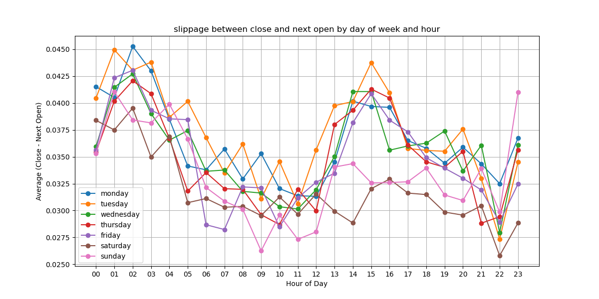

### `relative_price_convergence/` — SOL vs BTC (Oct–Nov 2025)
Regress SOL's 5-minute % change on BTC's (`SOL = -0.0003 + 1.277·BTC`, R² ≈ 0.5),
treat the fitted line as a relative price level, and test whether deviations
converge. **Result:** the residual predicts the best move towards the line over
the next 15 candles with slope −0.0256, R² 0.28, t = −130 on n = 43,900, and more
over 288 candles; a random-sampling test (`05_`) confirms the sign across
windows. Not tradeable: the expected move at 5-minute frequency sits inside the
0.15% round-trip fee.

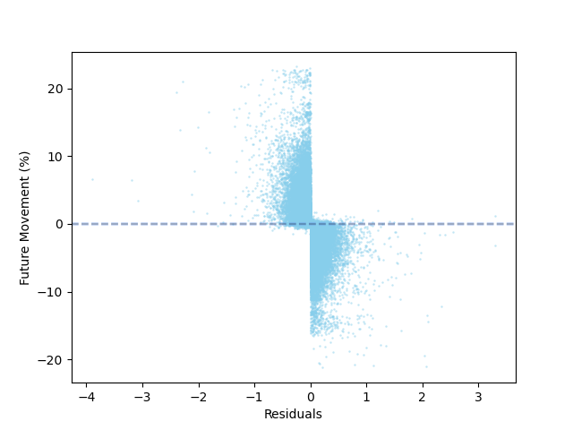

*Residual of the SOL~BTC regression (x) against the best move towards the fitted
line over the next day (y): the wedge is the convergence, its width is why it
does not pay 0.15% per round trip at 5-minute frequency.*

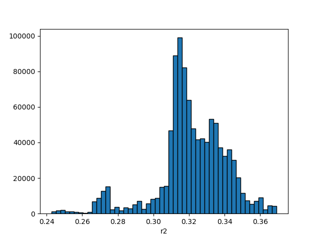

*R² of the same regression on random windows (`05_random_sampling_test.py`):
the relation holds in every regime, centred on ~0.32.*

### `trend_following/` — REGEX on hourly candles (Feb–Jun 2026)
Clean re-implementation of the regression-slope signal on the new hourly
database: volume-weighted slopes, a long-lookback "bias" filter, log-spaced
lookbacks, and a regression of the forward extrema (best and worst move over
the next 48 candles) on the signal, to test whether it carries information
before any trading rule is written. `regex_03_slippage_estimation.py`
calibrates the slippage assumption a backtest would use. **Status:** weighted
and unweighted signals differ materially but neither is clearly better; the
backtest was scaffolded (`regex_02.py`) and not completed, and nothing from
this family has been deployed.

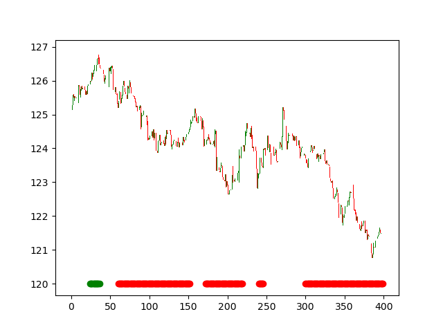
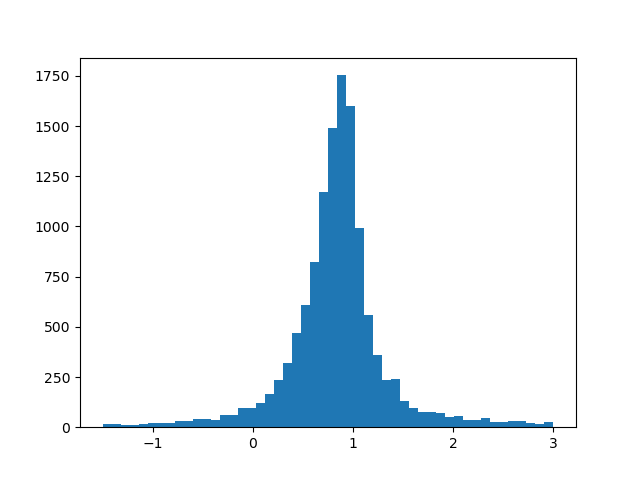

*Top: hourly candles with the signal/bias filter (green long, red short).
Bottom: ratio of volume-weighted to unweighted signal — centred below 1 with
fat tails, so the weighting changes individual signals materially.*

### `volatility_events/` — expected move ranges (Mar 2026)
How far price travels up and down over the next n candles, unconditionally and
conditional on the past window and on the REGEX signal. The groundwork for the
conditional-density work below. **Result:** ~4% expected excursion in either
direction over 48 hours; a weak relation between past and future excursions.

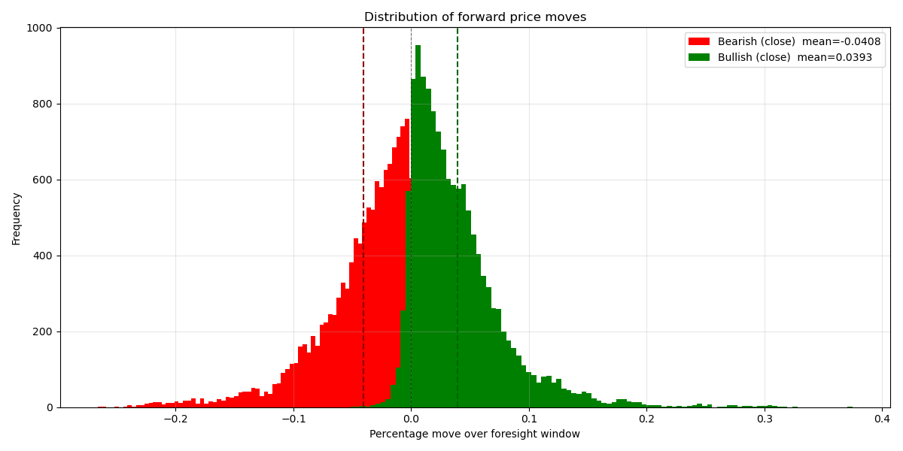
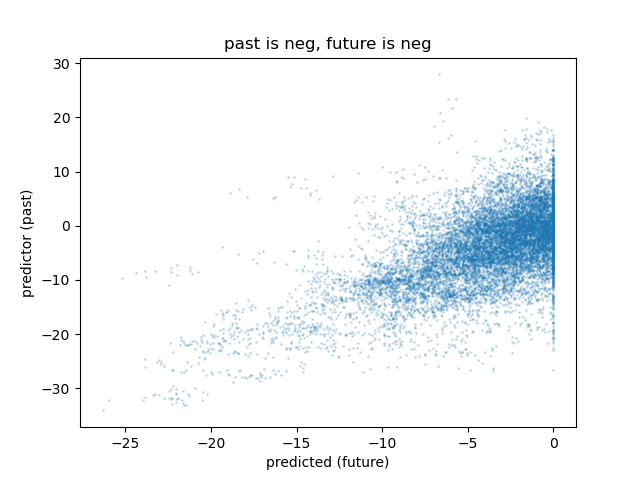

*Top: forward bearish (red, mean −4.1%) and bullish (green, mean +3.9%) moves
over the 48-hour window. Bottom: past vs future bearish excursion — the relation
is there, and it is weak.*

### `conditional_density/` — SKCDE (May–Jun 2026)
"Statistical methods to exploit a purely random market": bin the bullish
excursion of a window, build the empirical distribution of the bearish excursion
conditional on each bin, and draw from it (smoothed kernel conditional density
estimation) to evaluate stop-loss / take-profit grids on 8.7 million conditioned
draws rather than the 13,499 real hourly candles. Fee-adjusted EV surface,
conditional bull-probability variant, and the ACF check used to size bootstrap
blocks. **Result:** the model reproduces the sample's excursion structure and
quantifies exactly how much predictive value an added variable would need to
make a rule profitable after fees; on its own, none of the grids is.

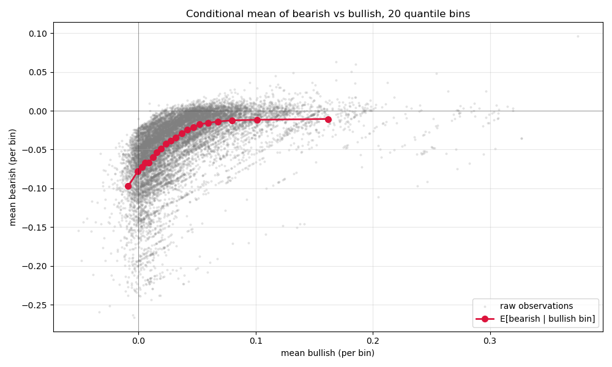

*The conditioning that SKCDE draws from: mean bearish move (y) per quantile bin
of the bullish move (x), over the raw observations in grey. Volatility
clustering shows up as the curve — the two excursions are not independent,
which is what the naive random-draw model got wrong.*

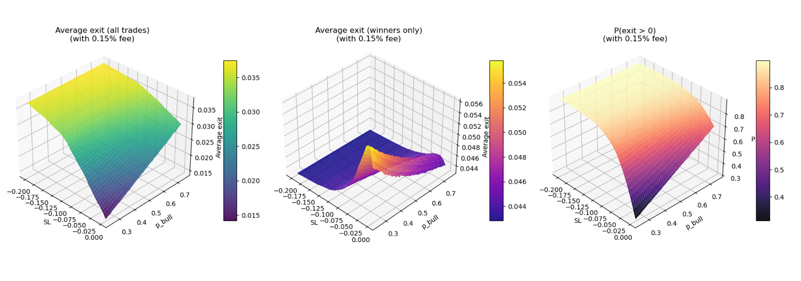

*Average exit over the stop-loss / take-profit grid with 0.15% fees, all trades,
winners only, and probability of a positive exit.*

### `synthetic_markets/` — null benchmarks (May 2026)
Block-bootstrap synthetic OHLC series (250-candle blocks, chosen from the
absolute-return ACF) matching the real sample's moments and quantiles to a few
percent, and the naive independent-draw model kept as a baseline.

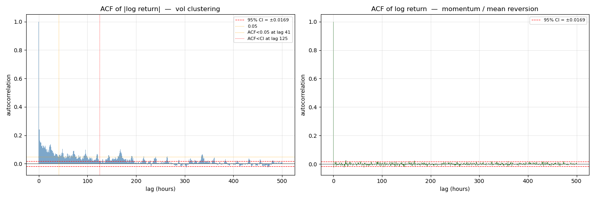
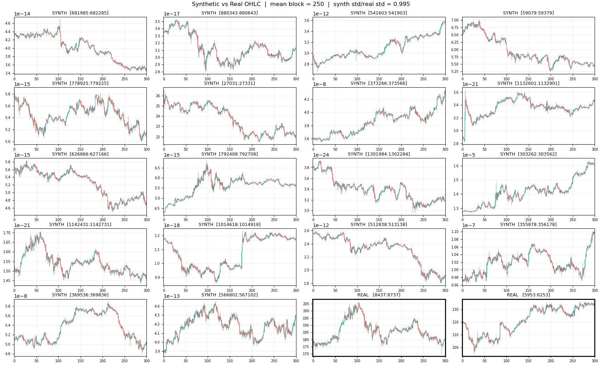

*Top: the absolute-return ACF (volatility clustering out to ~125 candles, 24h
spikes) that sets the 250-candle block length; raw returns show no memory.
Bottom: random extracts of the synthetic series next to real ones.*

### `volatility/` — volatility structure (May 2026)
Garman-Klass / Parkinson realised volatility of SOL and BTC vs USDC/USDT trading
volume, Pearson and Spearman over several windows; used as regime context.

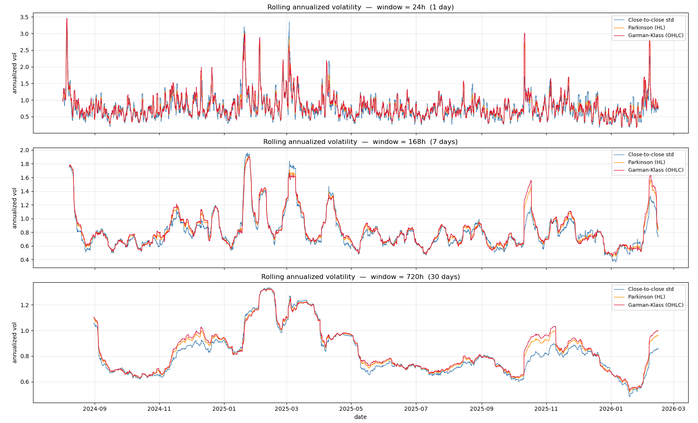

## Running things

```
pip install -r requirements.txt
```

Scripts read SQLite databases under `data/`: `data/crypto.db` for the 2026
schema (hourly and 5-minute tables with volume) and `data/SQL001.db` for the 2025
schema used by `regtrend/` and `relative_price_convergence/`. `data/README.md`
documents both and explains how to point a script at the bundled 1,081-candle
sample. Plots open in a window; run headless with `MPLBACKEND=Agg`.

## Honest limitations

Hardcoded parameters, a few magic column indices, and minimal error handling —
these are the scripts as they were used, with names and imports cleaned up for
publication. The equity portfolio work referenced in my CV is a separate repo:
[equity-portfolio-risk](https://github.com/Louisx14/equity-portfolio-risk).
